# Face Mask Detection: Complete Project Explanation

> ML Lab Mini Project. This document explains **what** the project does, **how** every part works, **why** each
> design decision was made, and **how to run it** yourself. Read it top to bottom before presenting.

---

## Table of contents

1. [What the project does](#1-what-the-project-does)
2. [How to run it locally (step by step)](#2-how-to-run-it-locally-step-by-step)
3. [The big picture: a two-stage pipeline](#3-the-big-picture-a-two-stage-pipeline)
4. [The dataset](#4-the-dataset)
5. [Preprocessing and data augmentation](#5-preprocessing-and-data-augmentation)
6. [Stage A: Face detection (SSD + ResNet-10)](#6-stage-a--face-detection-ssd--resnet-10)
7. [Stage B: Mask classification with transfer learning](#7-stage-b--mask-classification-with-transfer-learning)
8. [Model architecture, layer by layer](#8-model-architecture-layer-by-layer)
9. [Inside MobileNetV2](#9-inside-mobilenetv2)
10. [Training](#10-training)
11. [Results](#11-results)
12. [Real-time webcam loop](#12-real-time-webcam-loop)
13. [Code walkthrough (file by file)](#13-code-walkthrough-file-by-file)
14. [Limitations and future work](#14-limitations-and-future-work)
15. [Glossary](#15-glossary)
16. [Likely viva / teacher questions](#16-likely-viva--teacher-questions)

---

## 1. What the project does

Given a **photo** or a **live webcam feed**, the program:

1. finds every human face in the frame, and
2. decides for each face whether the person is wearing a **mask** or **not**, with a confidence score.

It draws a **green box** labelled `Mask: 99.4%` or a **red box** labelled `No Mask: 98.7%` around each face.

| | |
|---|---|
| **Problem type** | Object detection (faces) + binary image classification (mask / no mask) |
| **Main technique** | Transfer learning with a pretrained CNN (MobileNetV2) |
| **Libraries** | TensorFlow / Keras (model), OpenCV (camera, images, face detector), scikit-learn (split + metrics), Matplotlib (plots) |
| **Test accuracy** | **99.2%** on 819 images never seen during training |
| **Speed** | ~81 ms per frame on a laptop CPU (≈ 12 FPS) |

---

## 2. How to run it locally (step by step)

### Prerequisites
- **Python 3.10 – 3.12** (developed on 3.12). Check with `python --version`.
- A webcam (only for the live demo).
- ~2 GB free disk space (TensorFlow is large).

### Step 1: Open a terminal in the project folder

```powershell
cd C:\Users\Peush\Desktop\mllabproject
```

### Step 2: Create and activate a virtual environment

A virtual environment keeps this project's libraries separate from the rest of your system.

```powershell
python -m venv .venv
.venv\Scripts\activate          # Windows PowerShell / CMD
# source .venv/bin/activate     # macOS / Linux
```

Your prompt should now start with `(.venv)`.

> **Already set up:** a `.venv` with all packages installed already exists in this folder, so you can skip to
> Step 4 and just activate it. If PowerShell blocks `activate`, run
> `Set-ExecutionPolicy -Scope CurrentUser RemoteSigned` once, or use `.venv\Scripts\python.exe` directly.

### Step 3: Install the dependencies

```powershell
pip install -r requirements.txt
```

### Step 4: Train the model (optional, already trained)

`models/mask_detector.keras` is already included. To retrain from scratch:

```powershell
python train.py --epochs 20
```

This takes roughly 10–25 minutes on a CPU. It prints accuracy per epoch, then a classification report and a
confusion matrix, and saves:
- `models/mask_detector.keras`: the trained model
- `models/training_plot.png`: loss/accuracy curves

Options: `--epochs`, `--batch` (default 32), `--lr` (default 1e-4), `--dataset`, `--model`.

### Step 5: Detect masks in a photo

```powershell
python detect_image.py --image path\to\photo.jpg --output result.jpg
```

A window shows the result (press any key to close) and the annotated image is saved as `result.jpg`.
Add `--no-show` to skip the window. Add `--confidence 0.3` to detect smaller or less clear faces.

Try it on a sample from the dataset:

```powershell
python detect_image.py --image docs\assets\demo_with_mask_0.jpg
```

### Step 6: Live webcam detection

```powershell
python detect_video.py
```

- Press **`q`** to quit.
- Wrong camera? Try `--source 1`.
- Run on a video file: `--source myclip.mp4`.

### Troubleshooting

| Problem | Fix |
|---|---|
| `ModuleNotFoundError: tensorflow` | Virtual env not active. Run `.venv\Scripts\activate` |
| `Could not open video source: 0` | Close other apps using the camera (Zoom/Teams), or try `--source 1` |
| Lots of TensorFlow log messages | Harmless. Hide them with `$env:TF_CPP_MIN_LOG_LEVEL="2"` |
| No faces detected | Use better lighting, face the camera, or lower `--confidence` |
| Slow FPS | Normal on older CPUs; close other heavy programs |

---

## 3. The big picture: a two-stage pipeline

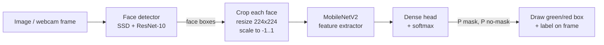

```
 ┌────────┐   ┌──────────────┐   ┌──────────────┐   ┌─────────────┐   ┌─────────┐   ┌──────────┐
 │ Input  │──▶│ Face detect  │──▶│ Crop+resize  │──▶│ MobileNetV2 │──▶│ Softmax │──▶│ Annotate │
 │ frame  │   │ (SSD)        │   │ 224×224      │   │ + head      │   │ 2 probs │   │ boxes    │
 └────────┘   └──────────────┘   └──────────────┘   └─────────────┘   └─────────┘   └──────────┘
              └──── Stage A: WHERE are the faces? ┘ └──── Stage B: is THIS face masked? ───────┘
```

**Why two stages instead of one model?**
- The face detector is **already solved**: OpenCV ships a good pretrained one. We reuse it.
- Our classifier then only sees **tightly cropped faces**, a much easier problem than whole scenes.
  That's why ~4,000 images are enough to reach high accuracy.
- Each stage can be swapped or improved on its own.

---

## 4. The dataset

| Class | Images |
|---|---|
| `with_mask` | 2,162 |
| `without_mask` | 1,930 |
| **Total** | **4,092** |

- Source: the open-source [chandrikadeb7/Face-Mask-Detection](https://github.com/chandrikadeb7/Face-Mask-Detection)
  repository (MIT licence). It contains real photos and some images with artificially added masks.
- The classes are **nearly balanced** (53% / 47%), so plain accuracy is a fair metric.
- **Split:** 80% training (3273 images) / 20% test (819 images), **stratified** (both
  splits keep the same class ratio) with a fixed `random_state=42`, so the split is reproducible.
- The test set is **never used for training**. All reported numbers come from it.

Folder layout expected by `train.py`:

```
dataset/
├── with_mask/       *.jpg / *.png
└── without_mask/    *.jpg / *.png
```

You can add your own images to these folders and retrain.

---

## 5. Preprocessing and data augmentation

Every image goes through these steps:

| Step | What | Why |
|---|---|---|
| Read | decode JPG/PNG to an RGB array | |
| Resize | 224 × 224 × 3 | MobileNetV2's native input size |
| Augment (training only) | random flip, rotation (±~22°), zoom (±15%), shift (±10%) | creates new variations every epoch, so the model learns pose and position invariance and overfits less |
| Normalise | `preprocess_input`: `pixel / 127.5 − 1` → range **[-1, 1]** | same scaling MobileNetV2 was pretrained with |
| Batch | 32 images per training step | |

The augmentation layers are **inside the model**. Keras automatically turns them **on during training** and
**off during prediction**, so inference images are never distorted.

Example augmentations (from `docs/assets/`):

| Original | Flip | Rotate | Zoom | Shift |
|---|---|---|---|---|
| 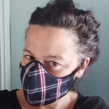 | 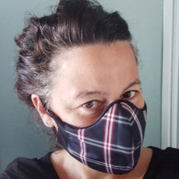 | 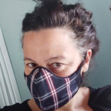 | 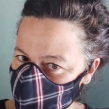 | 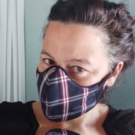 |

---

## 6. Stage A: Face detection (SSD + ResNet-10)

We use OpenCV's **pretrained** deep-learning face detector (files in `face_detector/`):
- `deploy.prototxt`: the network structure
- `res10_300x300_ssd_iter_140000.caffemodel`: the trained weights

**We do not train this model.** It is used as-is.

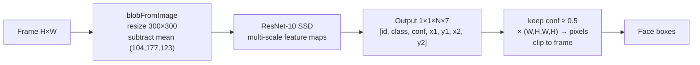

**SSD = Single Shot MultiBox Detector.** "Single shot" means one forward pass predicts every box at once. It
predicts boxes from feature maps of several sizes: large maps find small faces, small maps find large faces.

**Output format.** For each of N candidate detections, the network gives 7 numbers:

| index | 0 | 1 | 2 | 3 | 4 | 5 | 6 |
|---|---|---|---|---|---|---|---|
| meaning | image id | class | **confidence** | x1 | y1 | x2 | y2 |

Coordinates are fractions (0–1) of the frame size, so we multiply by `(W, H, W, H)` to get pixels.

**Why not Haar cascades** (the classic OpenCV face detector)? Haar cascades look for the light/dark pattern of the
nose and mouth, and **a mask covers exactly that**. The DNN detector is much more robust to masks, head turns
and bad lighting.

---

## 7. Stage B: Mask classification with transfer learning

Training a deep CNN **from scratch** needs hundreds of thousands of images. We have ~3,300 for training. The
solution is **transfer learning**:

```
STEP 1: Google trained MobileNetV2 on ImageNet (1.28 M images, 1000 classes)
   [conv block 1: edges] → [block 2: textures] → [block 3: parts] → [block 4: objects] → [1000-class head]
                                                                                           ✗ thrown away
STEP 2: Our model
   [   same conv blocks, weights COPIED and FROZEN (2,257,984 params)   ] → [NEW 2-class head]
                                                                             TRAINED (164,226 params)
```

- Early CNN layers learn **general** features (edges, colours, textures, shapes) that are useful for almost any
  image task, including "is there fabric over the mouth?".
- We **freeze** those layers (`base.trainable = False`) and only train a small new **head**.
- Result: we train only **6.8%** of the parameters. Training takes minutes on a CPU, needs little data
  and is less prone to overfitting.

---

## 8. Model architecture, layer by layer

| # | Layer | Output shape | Trainable params | Purpose |
|---|---|---|---|---|
| 1 | Input | 224 × 224 × 3 | 0 | RGB face crop |
| 2 | Augmentation (flip/rotate/zoom/translate) | 224 × 224 × 3 | 0 | training-time variety |
| 3 | MobileNetV2 base (frozen) | 7 × 7 × 1280 | 0 (2,257,984 frozen) | extract visual features |
| 4 | AveragePooling2D (7×7) | 1 × 1 × 1280 | 0 | average each feature over the face → one value per feature |
| 5 | Flatten | 1280 | 0 | make it a vector |
| 6 | Dense(128, ReLU) | 128 | 163,968 = 1280×128 + 128 | learn which feature combinations mean "mask" |
| 7 | Dropout(0.5) | 128 | 0 | randomly drop half the units in training → less overfitting |
| 8 | Dense(2, softmax) | 2 | 258 = 128×2 + 2 | output P(mask), P(no mask) |

**Total:** 2,422,210 parameters, of which **164,226 trainable** and 2,257,984 frozen.

**Softmax** turns two raw scores `z₁, z₂` into probabilities that sum to 1:

```
P(class i) = e^(z_i) / (e^(z_1) + e^(z_2))
```

The predicted class is the one with the higher probability. That probability is the confidence shown on screen.

**ReLU** (Rectified Linear Unit) = `max(0, x)`. It adds non-linearity so the network can learn complex patterns.

---

## 9. Inside MobileNetV2

MobileNetV2 (Sandler et al., Google, 2018) is a CNN designed to be **small and fast** enough for phones, which is
why it runs in real time on a laptop CPU. It is built from 17 **inverted residual blocks**:

```
        input (thin, e.g. 24 channels) ─────────────────────┐
              │                                              │ skip connection
              ▼                                              │
   1×1 Conv  EXPAND ×6 → 144 ch  + BatchNorm + ReLU6         │
              │                                              │
              ▼                                              │
   3×3 DEPTHWISE Conv (one filter per channel) + BN + ReLU6  │
              │                                              │
              ▼                                              │
   1×1 Conv  PROJECT → 24 ch  + BN   (linear, no ReLU)       │
              │                                              │
              ▼                                              │
             (+) ◀───────────────────────────────────────────┘
              │
           output
```

**Depthwise separable convolution** is the key trick:

| | Cost (per pixel) |
|---|---|
| Normal 3×3 conv | `9 · C_in · C_out` |
| Depthwise 3×3 + pointwise 1×1 | `9 · C_in + C_in · C_out` |

With `C_out` in the hundreds this is **~8–9× fewer multiply-adds** at almost the same accuracy.

- **"Inverted"** because a normal ResNet block goes wide → narrow → wide, and this goes narrow → wide → narrow.
- **Linear bottleneck:** the last 1×1 conv has no ReLU, because ReLU on a low-dimensional representation destroys
  information.
- **Skip connection:** adds the input to the output (as in ResNet), so gradients flow easily through deep networks.

---

## 10. Training

| Setting | Value | Why |
|---|---|---|
| Optimizer | **Adam**, learning rate `1e-4` | adaptive optimizer; small LR because we build on pretrained features |
| Loss | **Sparse categorical cross-entropy** | standard for classification with integer labels |
| Batch size | 32 | |
| Epochs | up to 20 | |
| Early stopping | stop if `val_loss` doesn't improve for 4 epochs, restore best weights | prevents overfitting and saves time |
| Checkpoint | save model whenever `val_accuracy` hits a new best | keep the best version |

**Cross-entropy loss** for one image = `−log(P(true class))`.
- Model says 0.99 for the right class → loss = 0.01 (good).
- Model says 0.10 for the right class → loss = 2.3 (bad).

**One training step:**

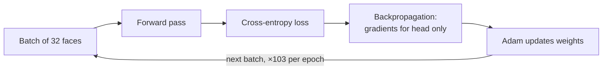

After every epoch the model is evaluated on the test split, checkpointed if it improved, and stopped early if the
validation loss stops falling.

### Learning curves (from the actual run)

| Epoch | Train acc | Val acc | Train loss | Val loss |
|---|---|---|---|---|
| 1 | 83.4% | 98.7% | 0.3904 | 0.0979 |
| 2 | 96.2% | 98.7% | 0.1266 | 0.0537 |
| 3 | 96.8% | 98.9% | 0.0895 | 0.0409 |
| 4 | 97.7% | 99.0% | 0.0716 | 0.0372 |
| 5 | 98.1% | 99.0% | 0.0600 | 0.0346 |
| 6 | 98.2% | 99.0% | 0.0534 | 0.0324 |
| 7 | 98.4% | 98.9% | 0.0532 | 0.0321 |
| 8 | 98.1% | 99.0% | 0.0521 | 0.0307 |
| 9 | 98.5% | 99.0% | 0.0449 | 0.0285 |
| 10 | 98.4% | 99.0% | 0.0438 | 0.0276 |
| 11 | 98.9% | 99.2% | 0.0363 | 0.0276 |
| 12 | 98.6% | 99.2% | 0.0403 | 0.0270 |
| 13 | 98.9% | 99.2% | 0.0318 | 0.0287 |
| 14 | 98.9% | 99.2% | 0.0322 | 0.0259 |
| 15 | 99.3% | 99.0% | 0.0267 | 0.0262 |
| 16 | 99.1% | 99.2% | 0.0268 | 0.0258 |
| 17 | 98.9% | 99.0% | 0.0324 | 0.0269 |
| 18 | 99.2% | 99.0% | 0.0232 | 0.0261 |
| 19 | 99.2% | 99.0% | 0.0259 | 0.0267 |
| 20 | 99.4% | 99.2% | 0.0262 | 0.0258 |

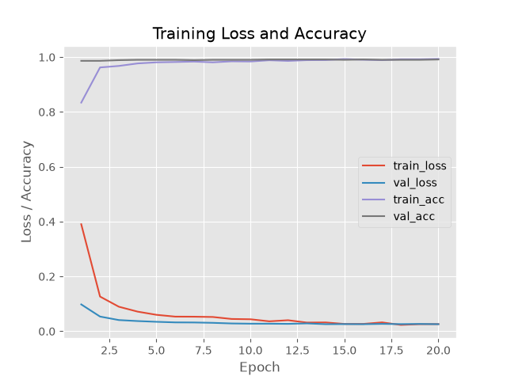

**Why is validation accuracy ≥ training accuracy?** Dropout and augmentation are only active during training,
which makes training harder. At evaluation time the full network sees clean images. This is normal and is
**not** overfitting. Overfitting would show as validation loss rising while training loss keeps falling.

---

## 11. Results

Evaluated on **819 held-out test images**:

| Class | Precision | Recall | F1-score | Images |
|---|---|---|---|---|
| Mask | 99.3% | 99.1% | 99.2% | 433 |
| No Mask | 99.0% | 99.2% | 99.1% | 386 |
| **Overall accuracy** | | | **99.2%** | 819 |

**Confusion matrix**

| | Predicted Mask | Predicted No Mask |
|---|---|---|
| **Actual Mask** | 429 ✅ | 4 ❌ |
| **Actual No Mask** | 3 ❌ | 383 ✅ |

**Metric meanings:**
- **Accuracy** = correct predictions / all predictions.
- **Precision** (for "Mask") = of all faces we *called* Mask, the fraction that really were masked.
- **Recall** (for "Mask") = of all faces that *really* were masked, the fraction we caught.
- **F1** = harmonic mean of precision and recall = `2·P·R / (P + R)`.

**Example outputs** (held-out test images annotated by `detect_image.py`):

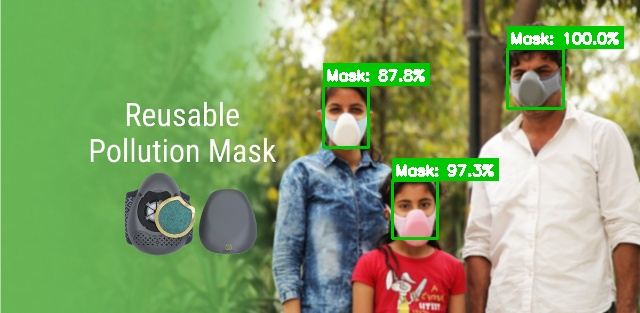 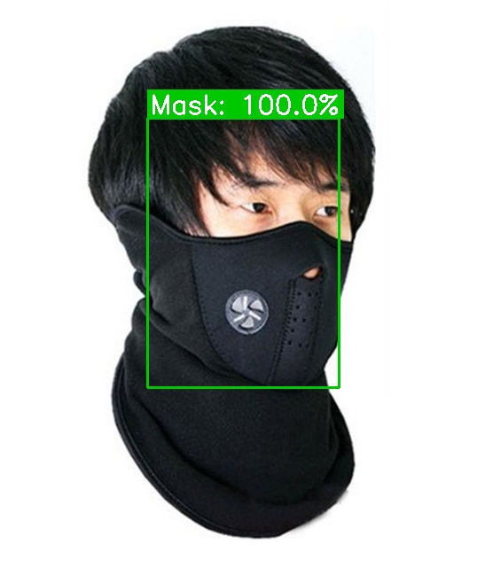 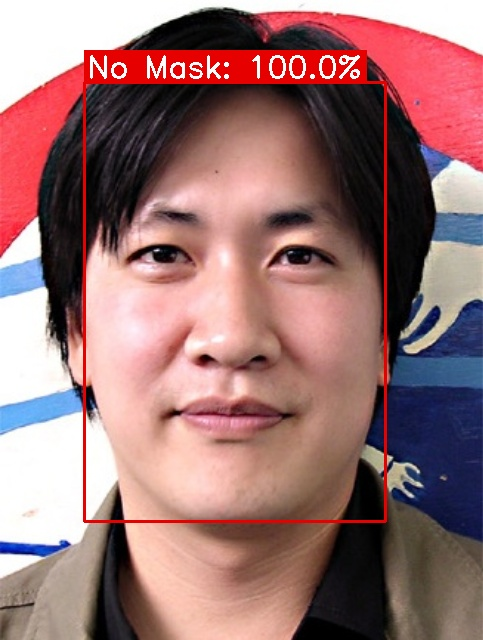 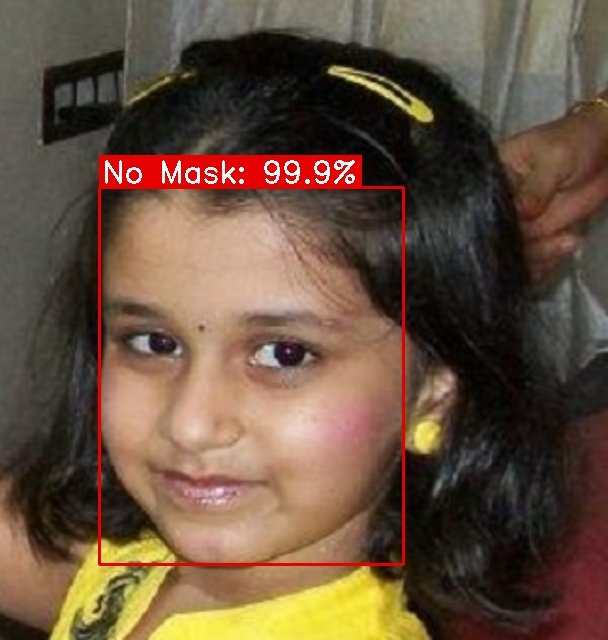

> **Caveat:** test images come from the same dataset as the training images, so real-world webcam accuracy will be
> somewhat lower, especially with unusual masks, extreme angles or poor lighting.

---

## 12. Real-time webcam loop

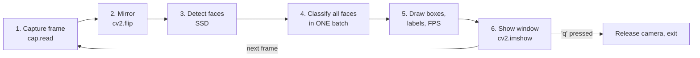

**Measured speed:** ~81 ms per 640×480 frame on the development laptop's CPU (one face), about **12 FPS**.

Why it's fast enough:
- the detector runs on a small 300 × 300 copy of the frame;
- MobileNetV2 is designed for mobile phones;
- all faces in a frame are classified in **one batched call** instead of one call per face.

---

## 13. Code walkthrough (file by file)

```
mllabproject/
├── dataset/                 training images (with_mask/, without_mask/)
├── face_detector/           pretrained OpenCV SSD face detector
├── models/
│   ├── mask_detector.keras  trained classifier
│   ├── training_plot.png    loss / accuracy curves
│   └── train_log.txt        full training output
├── docs/
│   ├── assets/              images + metrics used by the presentation and this doc
│   └── make_assets.py       regenerates docs/assets/
├── train.py                 build, train and evaluate the classifier
├── mask_detector.py         shared face detection + classification logic
├── detect_image.py          CLI: run on one photo
├── detect_video.py          CLI: run on webcam / video
├── requirements.txt
├── README.md                quick-start
├── PROJECT_EXPLANATION.md   this file
└── Face_Mask_Detection_Presentation.pptx
```

### `train.py`
| Function | What it does |
|---|---|
| `load_dataset(root)` | walks `dataset/with_mask` and `dataset/without_mask`, returns file paths and labels (0 = with_mask, 1 = without_mask) |
| `decode(path, label)` | reads one image file, decodes it and resizes to 224×224 |
| `make_ds(...)` | builds a fast `tf.data` pipeline: shuffle → decode → `preprocess_input` → batch → prefetch |
| `build_model()` | augmentation block + frozen MobileNetV2 + new head (see Section 8) |
| `main()` | parses CLI args, splits 80/20, compiles with Adam + cross-entropy, trains with checkpoint + early stopping, prints the classification report and confusion matrix, saves the model and plot |

### `mask_detector.py`
Class `MaskDetector`:
| Method | What it does |
|---|---|
| `__init__` | loads the SSD face detector (`cv2.dnn.readNet`) and our Keras model |
| `detect_faces(frame)` | builds a 300×300 blob, runs the SSD, keeps detections with confidence ≥ threshold, converts to pixel boxes and clips them to the frame |
| `predict(frame)` | crops each face, converts BGR→RGB, resizes to 224×224, applies `preprocess_input`, classifies **all faces in one batch**, returns `(box, class_index, probability)` |
| `draw(frame, results)` | draws a coloured box and a filled label (`Mask: 99.1%`) above each face |

### `detect_image.py`
Reads `--image`, runs `MaskDetector.predict`, prints one line per face, draws the boxes, optionally saves
(`--output`) and shows the result.

### `detect_video.py`
Opens the webcam (`--source 0`) or a video file, then loops: read frame → mirror → predict → draw → FPS → show,
until `q` is pressed.

---

## 14. Limitations and future work

**Limitations**
- Only 2 classes, so a mask worn **below the nose** may still be classified as "Mask".
- Part of the dataset uses **synthetic masks**, so real-world accuracy is lower than the test score.
- Very small, side-on or blurred faces may be **missed by the detector** (the classifier never sees them).
- No tracking between frames, so labels can **flicker** in video.

**Future work**
- Add a third class: **mask worn incorrectly**.
- **Fine-tune** the top layers of MobileNetV2 (unfreeze and train with a very low learning rate) on more diverse
  real photos.
- Export to **TensorFlow Lite / ONNX** for Raspberry Pi or Android deployment.
- Build a **Streamlit / Flask** web interface with alerts and a compliance counter.
- Use a newer detector (e.g. YuNet, RetinaFace, YOLO-face) for better small-face detection.

---

## 15. Glossary

| Term | Meaning |
|---|---|
| **CNN** | Convolutional Neural Network: a network that slides small learned filters over an image to detect patterns |
| **Transfer learning** | reusing a model trained on one task as the starting point for another |
| **Frozen layer** | a layer whose weights are not updated during training |
| **Epoch** | one full pass over the training set |
| **Batch** | the group of images processed before one weight update |
| **Augmentation** | random changes to training images to artificially increase variety |
| **Dropout** | randomly disabling neurons during training to reduce overfitting |
| **Softmax** | turns raw scores into probabilities that sum to 1 |
| **Cross-entropy** | loss function: `−log(probability of the true class)` |
| **Adam** | an adaptive gradient-descent optimizer |
| **Overfitting** | memorising training data instead of learning general patterns, so the model does badly on new data |
| **SSD** | Single Shot MultiBox Detector: an object detector that predicts all boxes in one pass |
| **Bounding box** | rectangle `(x1, y1, x2, y2)` around an object |
| **Confidence threshold** | minimum detector score to accept a face (default 0.5) |
| **Precision / Recall / F1** | see Section 11 |

---

## 16. Likely viva / teacher questions

**Q: Why MobileNetV2 and not VGG16 / ResNet-50?**
It is ~40× smaller than VGG16 and much faster, so it runs in real time on a CPU. Accuracy on this two-class face
task is already ~99%, so a bigger model gains almost nothing.

**Q: Why freeze the base model?**
With only ~3,300 training images, updating 2.2 M pretrained weights would quickly overfit. Freezing keeps the
general ImageNet features and only learns the final decision.

**Q: What does the face detector contribute? Why not classify the whole image?**
Whole images have backgrounds, several people and different scales. Cropping faces first gives the classifier a
clean, consistent input and lets us label each person separately.

**Q: Is the model overfitting?**
No. Validation accuracy matches or beats training accuracy and validation loss keeps falling (Section 10). Early
stopping would stop training if validation loss started rising.

**Q: What is the 224 × 224 size?**
The input size MobileNetV2 was trained with on ImageNet. The pretrained filters work best at that scale.

**Q: Why normalise to [-1, 1]?**
That is the pixel range MobileNetV2 saw during ImageNet pretraining. Using a different range would confuse the
pretrained features.

**Q: Can it handle multiple people?**
Yes. The detector returns every face and all crops are classified in one batch.

**Q: How would you improve it?**
See Section 14: a third "incorrectly worn" class, fine-tuning, more real-world data, a better detector, and
deployment to TFLite.
